# Промты

Коллекция промтов для **Nano Banana**: чёрно-белые векторные иконки и глифы. Каждый промт проверен на практике — результат показан прямо под описанием.

Тексты промтов оставлены на английском: модель стабильнее понимает английские формулировки, а менять в них почти ничего не нужно.

## Содержание

- [Kamon crests](#kamon-crests)
- [Modular geometry](#modular-geometry)
- [Dragon emblems](#dragon-emblems)
- [Op-art circles](#op-art-circles)
- [Angular chevrons](#angular-chevrons)
- [Arrow icons](#arrow-icons)
- [Sparkle stars](#sparkle-stars)
- [Flame icons](#flame-icons)
- [Tribal suns](#tribal-suns)
- [Rotational symmetry](#rotational-symmetry)
- [Liquid blobs](#liquid-blobs)
- [Cyber-tribal sigils](#cyber-tribal-sigils)
- [Street-art ornaments](#street-art-ornaments)
- [Pixel OS icons](#pixel-os-icons)
- [Pixel arcade glyphs](#pixel-arcade-glyphs)
- [Industrial hazard](#industrial-hazard)
- [Cargo markings](#cargo-markings)
- [Concept collisions](#concept-collisions)
- [Negative space](#negative-space)
- [Implied motion](#implied-motion)
- [Abstract metaphors](#abstract-metaphors)
- [Anti-cliche](#anti-cliche)
- [Three-shape icons](#three-shape-icons)
- [Abstract concepts](#abstract-concepts)
- [Signature rules](#signature-rules)
- [Ambiguous silhouettes](#ambiguous-silhouettes)

---

## Иконки

### Kamon crests

6 круглых иконок в эстетике японских фамильных гербов камон.


**Промт**

```text
A collection sheet of 6 distinct circular minimalist logo icons, arranged in a neat, balanced grid on an isolated solid white background. Independently invent a unique, compelling visual theme and motif, freely exploring any aesthetic direction, symbolism, abstract concept, or combination of ideas. Use creative intuition to determine the most striking visual identity for each icon, avoiding generic, predictable, or repetitive designs. Japanese kamon crest aesthetic, neo-tribal vector graphics, bold abstract geometry, rotational symmetry, dynamic curves and sharp tapered edges, intricate yet balanced compositions, clever negative space, distinctive silhouettes, sophisticated visual symbolism. Each logo should feel original, memorable, and carefully designed, with its own unique visual concept while maintaining a cohesive overall style. Solid black silhouettes on pure white, flat 2D graphic design, clean vector stencil, high contrast, crisp edges, professional logo design, no gradients, no shadows, no 3D rendering, no textures, no colors, no text, no lettering, no mockups.
```

### Modular geometry

Модульная геометрия: вложенные фигуры, разрывы и негативное пространство.


**Промт**

```text
A 2x3 grid layout displaying 6 distinct minimalist geometric logo icons. Pure flat black and white vector graphics on a clean white background, stark high contrast. Each icon explores unique modular geometric concepts, including interlocking shapes, nested squares, overlapping blocks, segmented forms, connected geometric structures, and clever negative space compositions. Swiss modernism, Y2K neo-brutalist aesthetic, retro-futuristic graphic design. Bold solid silhouettes, precise cutouts, asymmetrical arrangements, fragmented geometry, and creative use of positive and negative space. Six unique compositions with balanced proportions, consistent visual weight, and strong iconic silhouettes. Solid flat black shapes on pure white background, clean vector lines, 2D flat graphic design, no gradients, no drop shadows, no 3D elements, no text, SVG logo sheet style.
```

### Dragon emblems

6 драконьих эмблем: агрессивная esports-геометрия плюс трайбл-кривые.

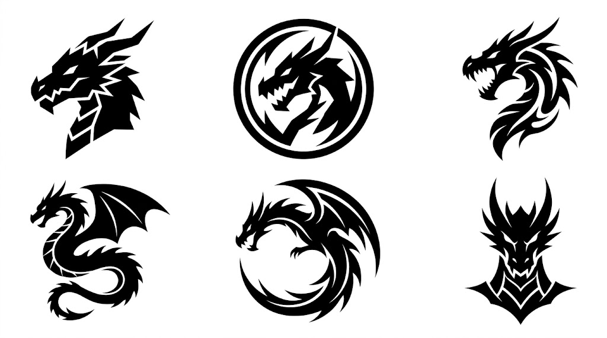

**Промт**

```text
A single 2D flat vector icon sheet arranged in a balanced 3-column-by-2-row grid containing exactly six distinct minimalist dragon emblem icons on a solid pure white background (#FFFFFF). All six icons are rendered in solid pure black (#000000) with crisp, razor-sharp edges, zero gradients, and no drop shadows. The design style combines aggressive angular esports mascot geometry with sweeping tribal curves, pointed spikes, jagged fangs, and sharp negative space cutouts for eyes and jawlines. Each icon occupies its own clearly separated space with consistent optical scale and generous margins: (1) an angular, faceted dragon head in side profile with swept-back horns and geometric neck cutouts; (2) a circular emblem featuring a jagged, geometric dragon silhouette framed by negative space; (3) a curved, roaring dragon head in profile with serrated teeth and spiked neck fins; (4) a full-body dragon coiled in an S-curve with an outstretched bat-like wing and a curled spiked tail; (5) a circular,ouroboros-style sweeping tribal dragon with an overarching curved wing and a crescent tail; and (6) a front-facing symmetrical dragon crest with sharp horns and angular cheek spikes. Maintain pure monochrome contrast with no text, watermarks, or borders.
```

### Op-art circles

Оп-арт: 12 круглых и органических форм из тонких параллельных линий.

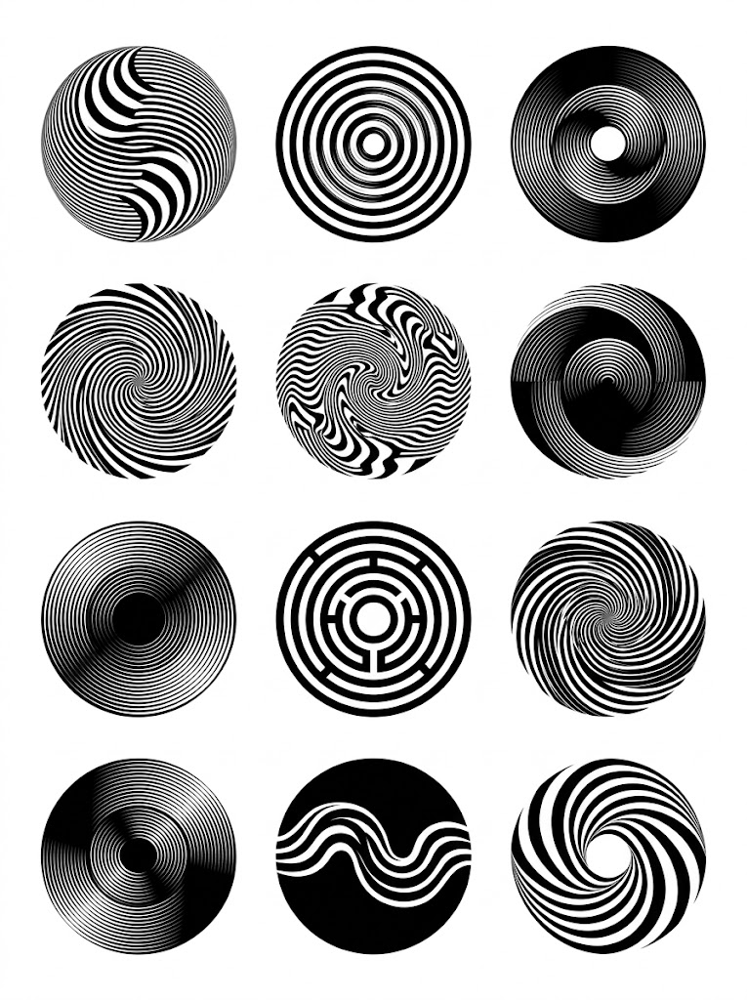

**Промт**

```text
A grid sheet of abstract minimalist black-and-white geometric logos on a pure white background, showcased in ultra-high-resolution with razor-sharp vector quality and flawless digital fidelity. Inspired by 1970s Swiss modernism, op-art, and Bauhaus aesthetics. Consists of 12 circular and organic shapes formed by highly intricate parallel lines of varying thickness, complex wave patterns, precise halftone stripes, mesmerizing optical illusions of volume, and masterful negative space. Striking, high-contrast flat vector graphics with perfectly smooth curves, crisp edges, and no pixelation or visual artifacting. Absolute creative freedom to generate unique, sophisticated geometric patterns, dynamic line rhythms, and bold abstract forms, while maintaining strict monochrome balance, pristine clarity, and professional graphic design quality on an expansive, empty white canvas.
```

**Вариант**

```text
A 2x3 grid layout displaying 6 distinct minimalist geometric logo icons. Pure flat black and white vector graphics on a clean white background, stark high contrast. Each icon explores unique angular geometric concepts, including triangles, pyramids, sharp chevrons, inverted V-shapes, intersecting arrows, diamonds, and jagged mountain-like patterns. 1970s modernist, cyberpunk, and outdoor-tech aesthetic. Bold solid silhouettes, clever negative space cutouts, parallel angular lines, intersecting sharp corners, fragmented geometry, and layered geometric forms. Six unique, balanced compositions with strong visual rhythm, clean razor-sharp edges, and consistent visual weight. Solid flat black shapes on pure white background, 2D flat graphic design, no gradients, no drop shadows, no 3D elements, no text, SVG logo sheet style.
```

### Angular chevrons

Сетка 4×4 из острых треугольных глифов в духе 70-х, киберпанка и outdoor-техники.

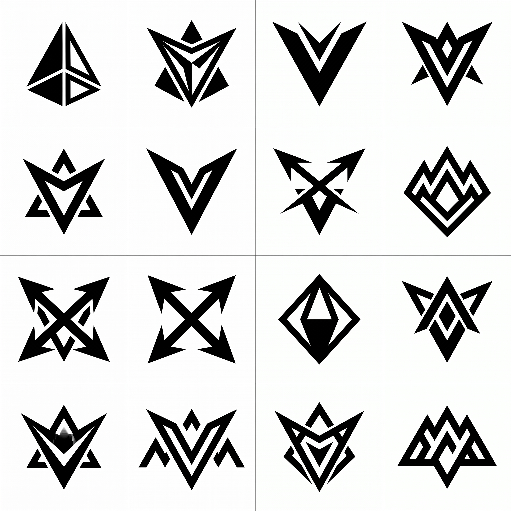

**Промт**

```text
A grid sheet of abstract, minimalist black-and-white geometric logos and sharp angular glyphs on a pure white background, showcased in ultra-high-resolution with razor-sharp vector quality and flawless digital fidelity. Inspired by 1970s modernist, cyberpunk, and outdoor-tech aesthetics. The symbols are focused on triangles, pyramids, sharp chevrons, inverted V-shapes, intersecting arrows, diamonds, and jagged, mountain-like patterns. Featuring a mix of bold solid geometry, inner cutouts, negative space, parallel angular lines, intersecting sharp corners, fragmentations, and overlayed geometric forms. Striking, high-contrast flat vector graphics with perfectly sharp edges, smooth straight lines, and balanced geometric weight, free from pixelation or digital artifacts. Absolute creative freedom to generate a diverse variety of unique, sharp, and avant-garde geometric symbols, V-shapes, triangular variations, and abstract badges, ensuring a rhythmic diversity of form across the 4x4 grid while maintaining a strict monochrome balance on an expansive, empty white canvas.
```

**Вариант**

```text
A 2x3 grid layout displaying 6 distinct minimalist abstract geometric logo icons. Pure flat black and white vector graphics on a clean white background, stark high contrast. Each icon explores unique circular and organic geometric concepts using intricate parallel lines, varying line thicknesses, flowing wave patterns, precise halftone stripes, optical illusions, and clever negative space. Inspired by 1970s Swiss modernism, Op Art, and Bauhaus aesthetics. A diverse combination of concentric circles, curved line patterns, flowing organic forms, warped geometric shapes, and mesmerizing optical compositions. Six unique designs featuring rhythmic linework, crisp edges, smooth curves, and balanced geometric weight. Solid flat black lines and shapes on pure white background, 2D flat graphic design, no gradients, no drop shadows, no 3D elements, no text, SVG logo sheet style.
```

### Arrow icons

Стрелочные иконки в квадратных рамках: динамика и негативное пространство.


**Промт**

```text
A 2x3 grid layout displaying 6 distinct minimalist geometric arrow logo icons. Pure flat black and white vector graphics, stark high contrast. Each icon explores unique abstract directional concepts using clever negative space, converging dynamic rays, sweeping curves, and sharp brutalist angles enclosed within square boundaries. Swiss modernist graphic design, bold iconic silhouettes, creative variations, clean solid background, no gradients, no 3D, no text.
```

### Sparkle stars

Четырёхлучевые звёзды и блики: от симметричных до наклонённых и фрагментированных.

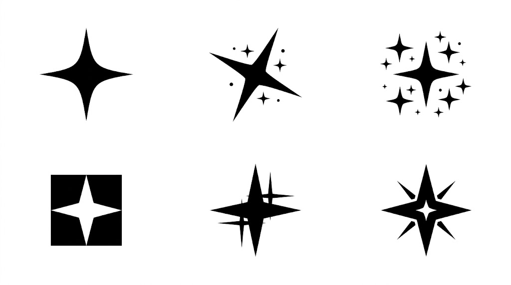

**Промт**

```text
A minimalist vector icon sheet featuring a 2x3 grid of 6 distinct four-pointed star and sparkle symbols on a solid pure white background. Each of the 6 icons explores a unique creative variation of the astroid star shape: symmetrical sparkles, dynamic tilted stars with elongated sharp rays, clusters of small and large glints, and clever negative space cutouts inside geometric shapes. Flat 2D vector graphics, stark black fill, razor-sharp edges, smooth concave curves, modern Y2K neo-brutalist logo aesthetic, high contrast, generous padding between icons, no gradients, no shadows, no text
```

### Flame icons

Пламя: острые языки, симметричные символы и фрагментированные силуэты.

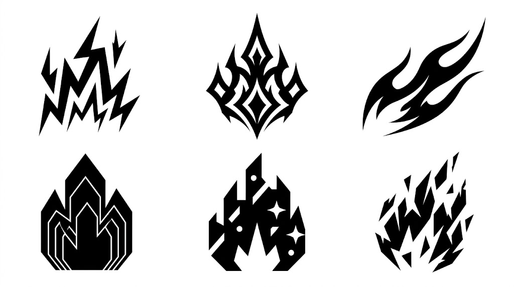

**Промт**

```text
A design sheet featuring 6 distinct minimalist flame-shaped geometric icons, neatly organized in a clean 2x3 grid layout, white background. Y2K neo-brutalist aesthetic, retro-futuristic geometric vector silhouettes. Each of the 6 icons features a unique variation: sharp angular flames, symmetrical fire symbols, elongated sweeping tongues of fire, abstract layered flame silhouettes, negative space cutouts, and fragmented flame shapes with dynamic pointed edges. Solid flat black shapes on pure white background, high contrast, clean vector lines, bold geometric composition, consistent visual weight, 2D flat graphic design, zero gradients, no drop shadows, no 3D elements, no text, SVG logo sheet style.
```

### Tribal suns

Трайбл-солнца с вращательным вихрем лучей.

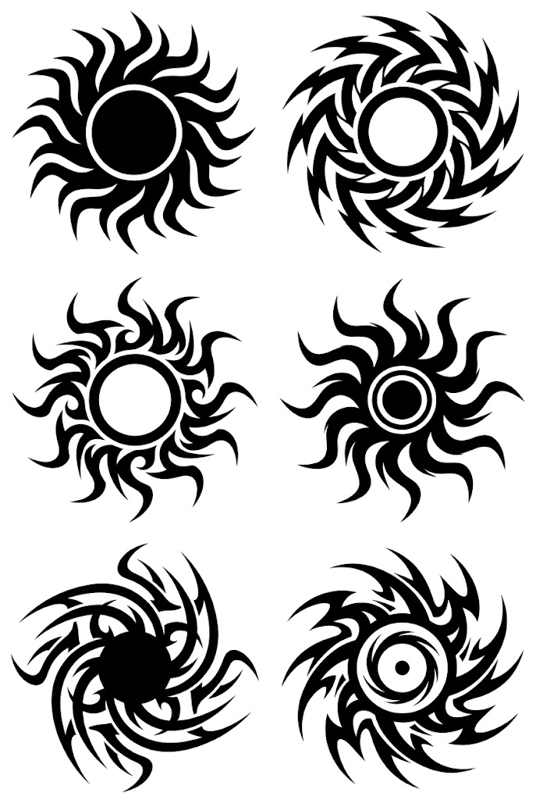

**Промт**

```text
A 2x3 grid layout icon sheet containing exactly 6 distinct tribal sun icons. Each icon features a central circular core (varying between solid black circles and hollow rings) surrounded by swirling, wavy, flame-like radiating rays with sharp pointed tips, creating a dynamic rotational vortex effect. Flat 2D vector silhouette style, 90s tribal tattoo flash art aesthetic, bold graphic stencil, sharp clean edges. Pure solid black icons isolated on a pure solid white background (#FFFFFF). High contrast monochrome, minimalist, no gradients, no shading, no gray tones, evenly spaced.
```

### Rotational symmetry

Строгая 3- и 4-лучевая симметрия в духе швейцарского модернизма.

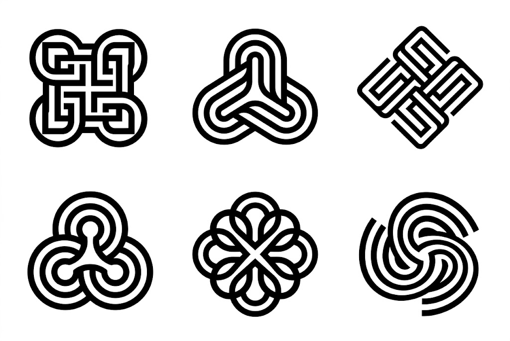

**Промт**

```text
A clean 3x2 grid layout displaying exactly 6 distinct minimalist geometric logo icons, evenly spaced with wide margins. Each icon features strict 3-fold or 4-fold rotational symmetry around a central point, constructed from repeating modular motifs: thick parallel curved stripes, interlocking rounded geometric loops, and monolinear spirals. Bold uniform stroke weight with precise, consistent negative space gaps between lines. Mid-century Swiss modernist corporate trademark aesthetic, brutalist flat 2D vector graphic design. Solid pure black (#000000) icons isolated on a completely flat, pure white (#FFFFFF) background. High contrast, razor-sharp edges, no gradients, no shadows, no 3D rendering, no text or borders.
```

### Liquid blobs

Кислотная графика: метаболы, амёбы и тающие кляксы с перемычками.

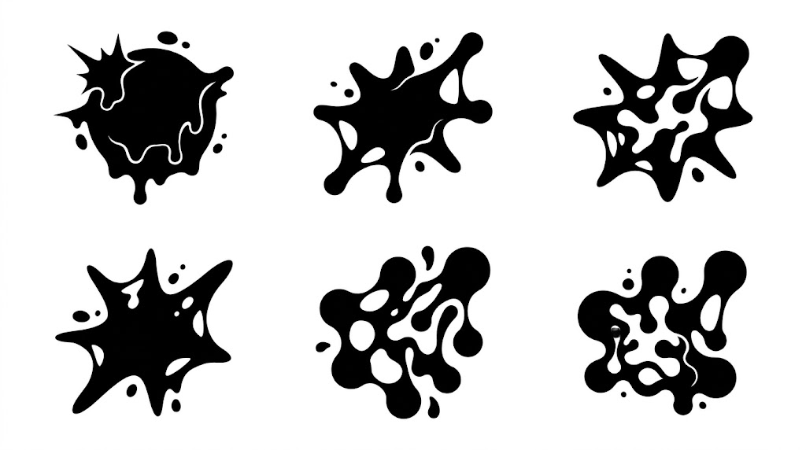

**Промт**

```text
A clean 3x2 grid layout displaying 6 distinct acid graphics liquid blob icons, evenly spaced. Merging metaballs, abstract amoeba droplets, and melting geometric shapes with stretched connection bridges. Y2K brutalist flat 2D vector style. Solid pure black (#000000) icons isolated on a pure white (#FFFFFF) background. Crisp edges, no gradients, no 3D shading, no text.
```

### Cyber-tribal sigils

Кибер-трайбл сигилы: готические шипы, крылья насекомых, каллиграфия.

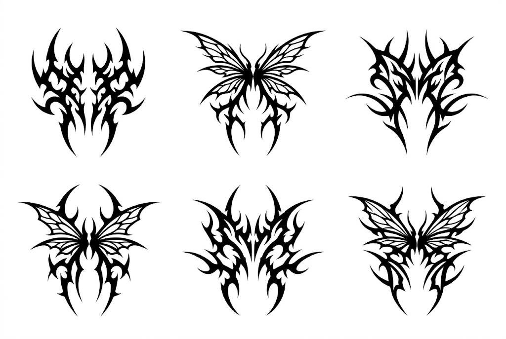

**Промт**

```text
A clean 3x2 grid layout displaying 6 distinct cyber-tribal sigil icons, evenly spaced. Symmetrical sharp gothic spikes, insect-wing motifs, and aggressive calligraphic flourishes. Y2K neo-tribal flat 2D vector graphic design. Solid pure black (#000000) icons isolated on a pure white (#FFFFFF) background. High contrast, razor-sharp edges, no gradients, no shadows, no text.
```

### Street-art ornaments

Уличные орнаменты: колючая проволока, цепи и шипастые рамки.

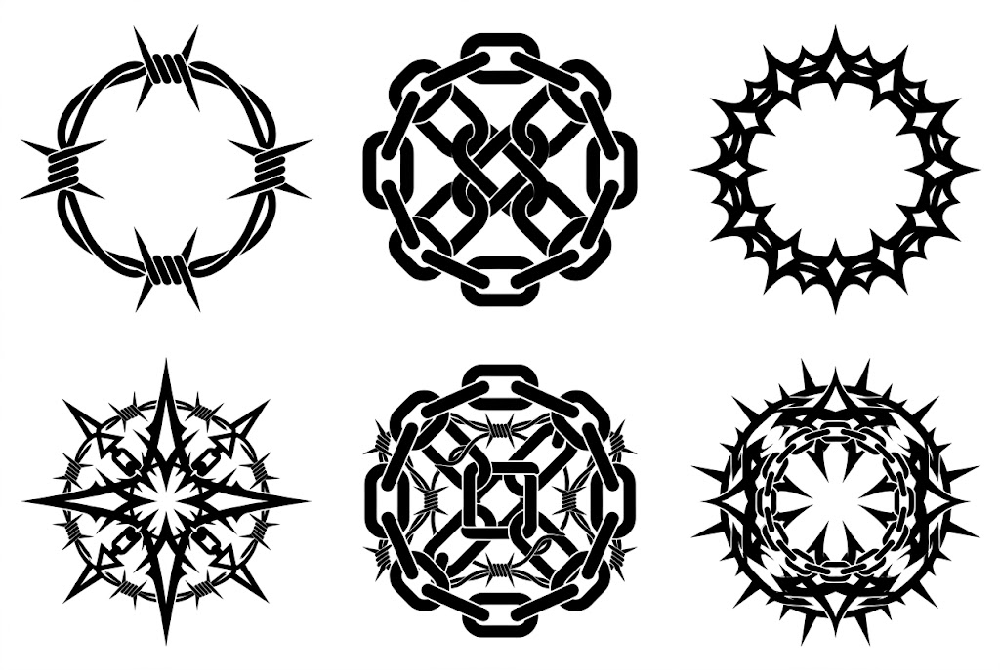

**Промт**

```text
A clean 3x2 grid layout displaying 6 distinct Y2K street-art ornament icons, evenly spaced. Stylized barbed wire loops, heavy interlocking chain links, and spiky circular frames. Brutalist flat 2D vector silhouette design with clean negative space. Solid pure black (#000000) icons isolated on a pure white (#FFFFFF) background. Sharp edges, no gradients, no text.
```

### Pixel OS icons

1-bit иконки в стиле Macintosh 1984 года.

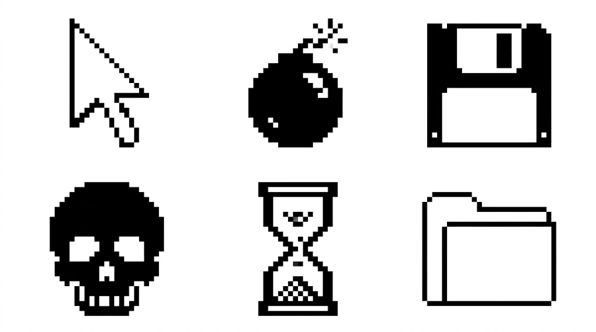

**Промт**

```text
3x2 grid of 6 distinct 1-bit retro OS pixel art icons: arrow cursor, system bomb, floppy disk, skull, hourglass, file folder. Chunky square pixels, 1984 Macintosh aesthetic. Solid pure black (#000000) on pure white (#FFFFFF) background. No anti-aliasing, no gradients, no text.
```

### Pixel arcade glyphs

8-битные аркадные глифы и ретро-игровые эмблемы.

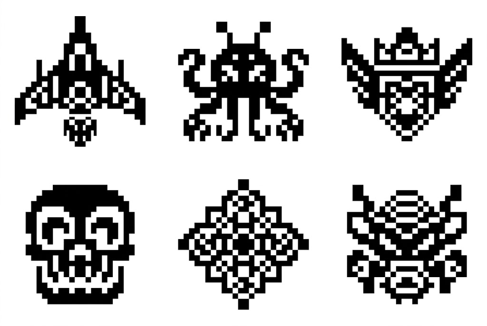

**Промт**

```text
3x2 grid of 6 distinct 8-bit arcade pixel glyphs and abstract retro gaming emblems. Blocky grid geometry, vintage sprite style. Solid pure black (#000000) on pure white (#FFFFFF) background. High contrast, no gradients, no text.
```

### Industrial hazard

Промышленные знаки опасности и техно-бейджи.

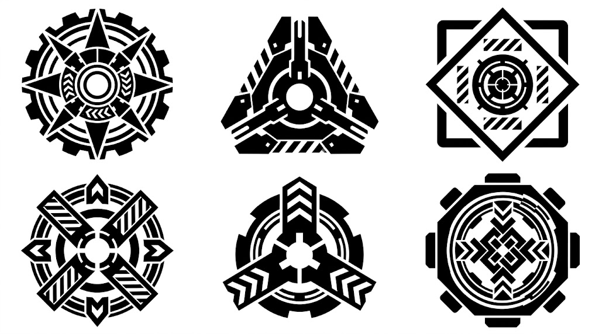

**Промт**

```text
A clean 3x2 grid layout displaying 6 distinct industrial marker and tech hazard badge icons, evenly spaced with wide margins. Heavily geometric, utilitarian motifs utilizing 3-fold, 4-fold, or bilateral symmetry. Abstract warning insignias, heavy caution hazards, sci-fi utility logos, and industrial classification symbols. Features heavy solid blocks, hazard warning stripes, gear-like mechanical elements, concentric technical rings, interlocking angular warning shapes, radiation/biohazard-inspired abstract geometry, and military/utility stamps. Stylized cargo labeling aesthetic, brutalist flat 2D vector graphic design. Solid pure black (#000000) icons isolated on a completely flat, pure white (#FFFFFF) background. High contrast, razor-sharp edges, no gradients, no shadows, no 3D rendering, no text, no border lines.
```

### Cargo markings

Трафаретная маркировка грузов и технической одежды.

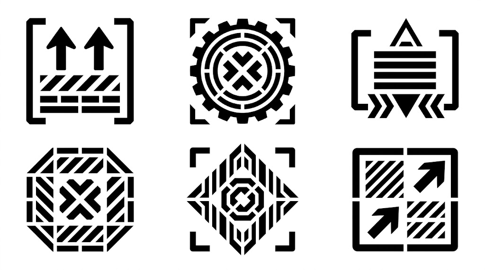

**Промт**

```text
A clean 3x2 grid layout displaying 6 distinct utilitarian cargo marking and technical apparel labeling icons, evenly spaced with wide margins. Heavily geometric, rugged industrial, shipping, and technical garment marking symbols, featuring abstract cargo handling glyphs, packaging and quality control indicator stamps, tracking and packing markers, and heavy directional symbols. Built from chunky stencils, heavy parallel stripes, angular bracket frames, stylized transport/handling stamp motifs, warning bars, fragmented geometric shapes, and abstract circular/square tracking stamps. Raw brutalist flat 2D vector graphic design inspired by ISO logistics and heavy-duty cargo marking. Solid pure black (#000000) icons isolated on a completely flat, pure white (#FFFFFF) background. High contrast, razor-sharp edges, no gradients, no shadows, no 3D rendering, no text or words, no outer border around the whole image. No 3D objects, no realistic vehicles. Flat 2D graphic design, purely 2-dimensional.
```

### Concept collisions

Неожиданное столкновение двух идей в одном символе.

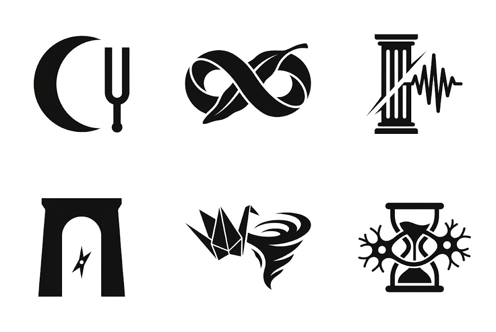

**Промт**

```text
Create a 3x2 concept sheet containing exactly 6 original standalone logo symbols. For each symbol, independently invent an unexpected collision between two different ideas, systems, or meanings, then fuse them into one coherent visual metaphor. Choose the concepts yourself; do not use a predefined list of objects or repeat the same type of concept collision. The result must feel like a newly discovered symbol, not two clip-art objects placed together. Explore different visual strategies across the sheet: transformation, interlocking forms, symbolic cuts, unexpected scale relationships, and carefully balanced asymmetry. Make every mark instantly distinguishable by silhouette and underlying idea, with enough simplicity to work as a real brand icon. Keep the meaning suggestive rather than literal or explanatory. Solid black shapes on a pure white background, flat 2D vector logo design, crisp edges, generous spacing, consistent optical weight. No text, letters, numbers, mockups, borders, gradients, shadows, textures, or 3D.
```

### Negative space

Негативное пространство со вторым прочтением.

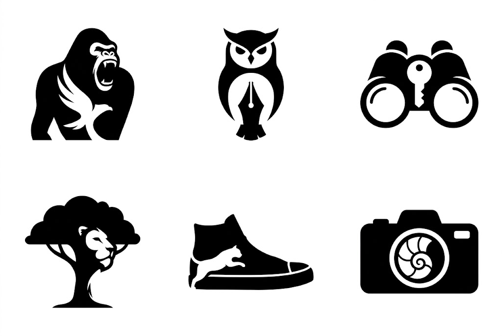

**Промт**

```text
Generate a balanced 3x2 grid of exactly 6 original minimalist logo marks built around clever negative space. Invent a different underlying idea for every mark and let the relationship between the solid silhouette and its empty cutouts reveal a subtle second reading. Do not rely on obvious heart-and-arrow, letter-in-shape, or animal-in-circle templates. Avoid familiar stock-logo formulas. Each symbol should have one strong outer silhouette and one intentional visual surprise that feels inevitable once noticed. Vary the construction logic across the six designs: enclosed voids, shared edges, interrupted contours, nested silhouettes, and forms that become meaningful only when viewed as a whole. Keep every design simple enough to remain legible at small sizes. Solid black and pure white only, flat vector geometry, clean cutouts, sharp edges, isolated on a white background. No text, typography, gradients, shadows, outlines around the sheet, mockups, textures, or 3D.
```

### Implied motion

Движение и переход без стрелок и линий скорости.

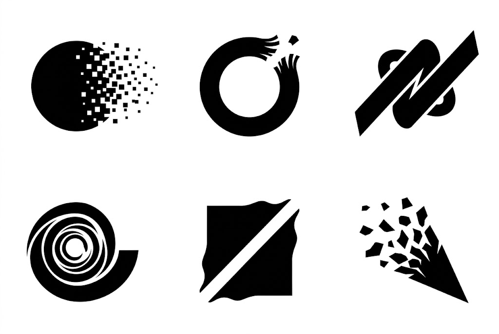

**Промт**

```text
Produce a 3x2 grid of exactly 6 original static logo symbols that make an action, transition, or force feel visible without drawing literal motion lines or relying on arrows. Invent a different process for each mark: something dividing, converging, unfolding, adapting, escaping, balancing, exchanging, or changing state—but freely choose the final concepts and do not simply illustrate these example verbs. Suggest motion through tension, shape deformation, directional weight, interrupted continuity, spatial relationships, or a before-and-after state fused into one form. Each icon must feel distinct in both meaning and silhouette; avoid six variations of the same swirl or forward-facing mark. Prioritize memorable, economical forms that could work as a real brand symbol. Solid black vector shapes on pure white, flat 2D design, crisp contours, carefully controlled negative space. No arrows as the main solution, no speed lines, text, letters, gradients, shadows, textures, mockups, borders, or 3D.
```

### Abstract metaphors

Абстрактные идеи и человеческий опыт через метафору.

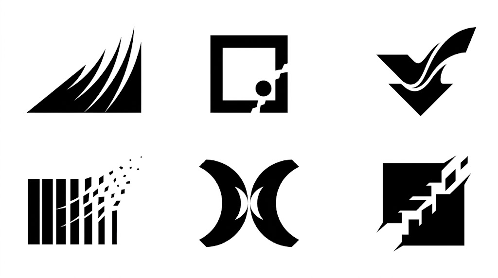

**Промт**

```text
Create exactly 6 distinct minimalist logo concepts in a clean 3x2 grid. Independently choose six different abstract ideas, qualities, or human experiences and invent a visual metaphor for each one. Communicate through shape, balance, rhythm, proportion, enclosure, interruption, compression, or transformation—not through literal illustrations or recognizable stock symbols. Do not write or display the concepts. Do not use a repeated icon template with superficial variations. Each mark should express its own idea through a different visual logic, while remaining simple, bold, and recognizable at small sizes. Aim for the kind of concise, surprising symbol a skilled identity designer might sketch after exploring many concepts. Use solid black and white only, flat 2D vector marks, crisp edges, generous negative space between icons, pure white background. No text, letters, numbers, gradients, shadows, textures, mockups, or 3D rendering.
```

### Anti-cliche

Символы для категорий, где очевидные решения отброшены.

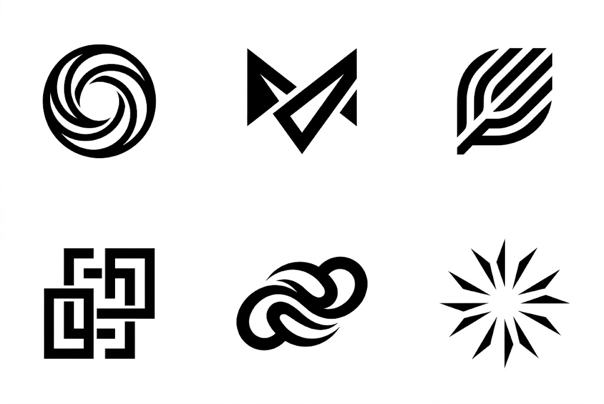

**Промт**

```text
Create a design exploration sheet containing exactly 6 original black-and-white logo symbols. First, independently invent six different brand categories or purposes. For each one, deliberately reject the first three obvious visual clichés that a designer would normally use for that category. Build the final symbol from a more surprising but still meaningful visual association, structural idea, or distinctive silhouette. The six marks must communicate six different concepts and must not share one dominant motif or construction. Prioritize memorable silhouettes, clear visual logic, and ideas that could inspire a real identity design rather than decorative variation. Arrange the symbols in a balanced 3x2 grid with generous whitespace. Solid black shapes on pure white, flat 2D vector style, crisp edges, scalable logo design, no gradients, no shadows, no 3D, no texture, no color, no letters, no numbers, no words, no mockups, no borders.
```

### Three-shape icons

Не больше трёх геометрических элементов на знак.

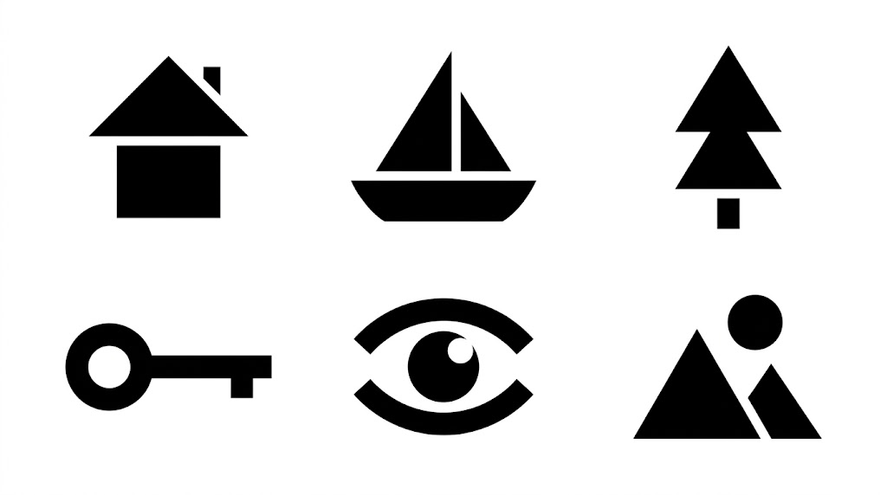

**Промт**

```text
Create exactly 6 original logo concepts in a 3x2 grid. Each logo may use no more than three simple geometric components, yet all six must communicate clearly different ideas. Do not make six variations of the same geometric symbol. Invent a different underlying concept for each mark, then reduce it to the smallest possible combination of circles, blocks, arcs, wedges, or custom simple silhouettes. The challenge is conceptual clarity, not geometric decoration: each shape must contribute to the idea. Use confident proportions, distinctive negative space, and memorable silhouettes that remain recognizable at small sizes. Pure black vector shapes on a clean white background, flat 2D, sharp edges, no gradients, no shadows, no 3D, no texture, no color, no letters, no numbers, no words, no mockups.
```

### Abstract concepts

Символы для понятий, которые сложно изобразить напрямую.

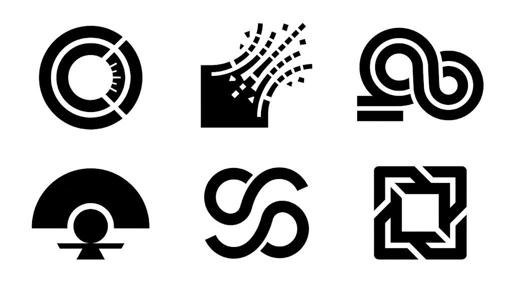

**Промт**

```text
Invent exactly 6 original symbols for concepts that are notoriously difficult to depict as icons, such as trust calibration, productive uncertainty, delayed understanding, quiet confidence, reversible decisions, shared responsibility, or other subtle ideas. Do not use faces, speech bubbles, hearts, check marks, question marks, or other conventional pictograms as shortcuts. Instead, invent a visual structure that expresses the concept through proportion, containment, tension, continuity, balance, or a carefully chosen absence. Each symbol must suggest a different idea and use a different visual logic. Keep the designs usable as real brand marks: simple enough to recognize, distinctive enough to remember, and free from explanatory detail. A balanced 3x2 grid, pure black vector shapes on white, flat 2D, no gradients, no shadows, no 3D, no color, no letters, no words, no captions, no mockups.
```

### Signature rules

У каждого знака — собственное конструктивное правило: повторяющийся срез, изгиб, пропорция.

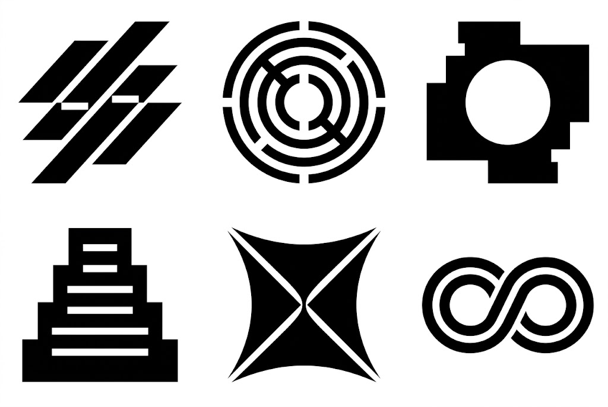

**Промт**

```text
Invent exactly 6 distinctive logo symbols, each based on its own original visual signature rule. A signature rule might involve a recurring cut, a characteristic bend, a specific way two masses meet, a consistent interruption, a peculiar ratio, or another simple construction principle—but invent a different rule for every symbol. Make the rule visible in the design without turning the sheet into a technical diagram. Each mark should feel ownable and reproducible, as if a brand could build a broader visual identity around that single formal idea. Avoid generic symbols and avoid repeating one construction trick across the six concepts. Present them in a clean 3x2 grid with generous spacing. Pure black flat vector forms on white, strong silhouettes, crisp edges, no gradients, no shadows, no 3D, no textures, no color, no text, no lettering, no mockups, no borders.
```

### Ambiguous silhouettes

Силуэты, которые читаются двумя способами: гора и корона, птица и книга.

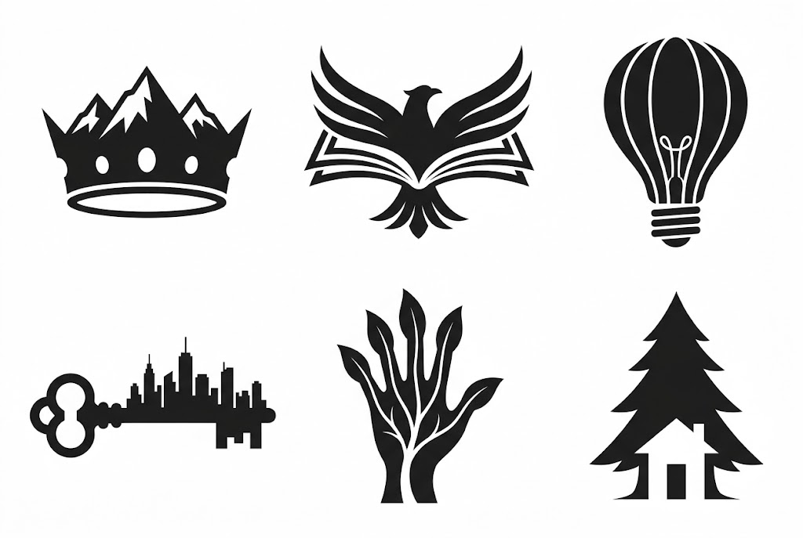

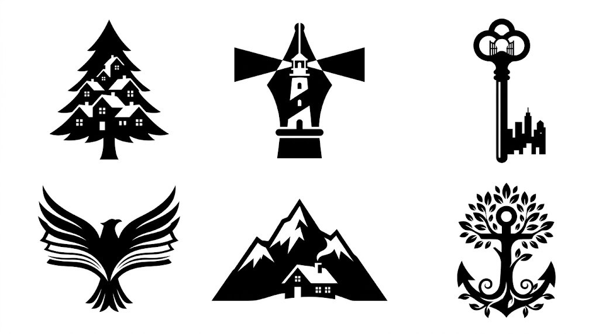

**Промт**

```text
Design exactly 6 standalone logo symbols whose outer silhouettes invite two or more compatible interpretations. The ambiguity must come from the form itself, not from tiny hidden pictures or elaborate optical tricks. A contour might suggest a place and a process, a natural structure and a manufactured one, or two related ideas depending on how it is read. Invent six different conceptual starting points and six different silhouette strategies. Keep every mark immediately readable as a coherent graphic shape; the secondary interpretation should reward a second look without making the primary one confusing. Do not add text or show explanatory callouts. Arrange the results in a balanced 3x2 grid, using solid black forms and deliberate white cutouts on a pure white background. Flat vector design, crisp edges, no gradients, no shadows, no 3D, no colors, no letters, no labels, no mockups.
```
