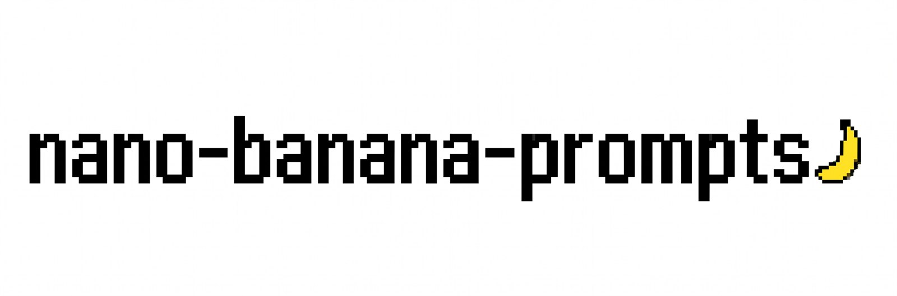

Коллекция промтов для **Nano Banana** — генерации чёрно-белых векторных логотипов, иконок и глифов. 17 промтов с примерами результатов и 2 дополнительных варианта. Тексты промтов на английском, интерфейс репозитория — на русском.

## Каталог

### Логотипы

<table>
  <tr valign="top">
    <td align="center" width="33%"><a href="PROMPTS.md#kamon-crests">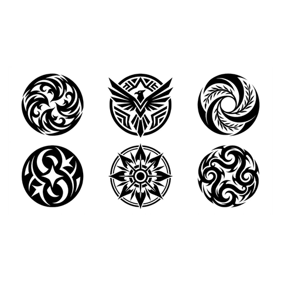</a><br><b>Kamon crests</b></td>
    <td align="center" width="33%"><a href="PROMPTS.md#modular-geometry">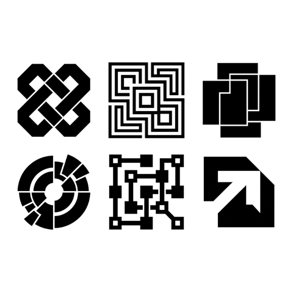</a><br><b>Modular geometry</b></td>
    <td align="center" width="33%"><a href="PROMPTS.md#dragon-emblems">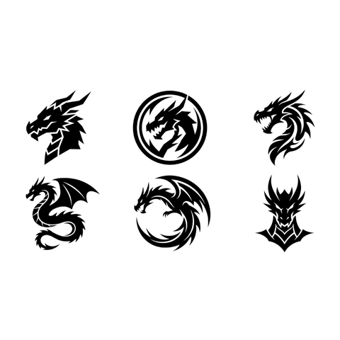</a><br><b>Dragon emblems</b></td>
  </tr>
</table>

### Иконки

<table>
  <tr valign="top">
    <td align="center" width="33%"><a href="PROMPTS.md#op-art-circles">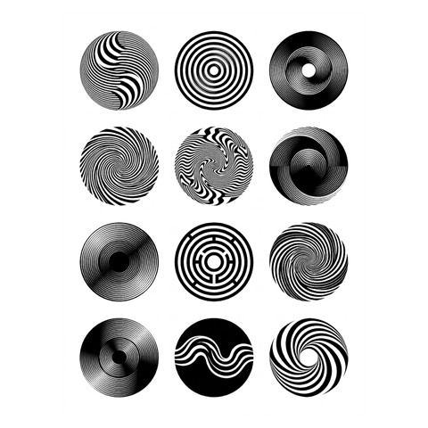</a><br><b>Op-art circles</b></td>
    <td align="center" width="33%"><a href="PROMPTS.md#angular-chevrons">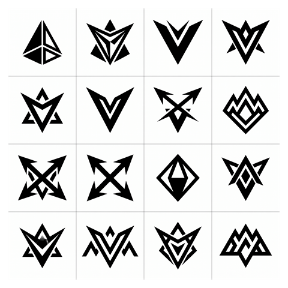</a><br><b>Angular chevrons</b></td>
    <td align="center" width="33%"><a href="PROMPTS.md#arrow-logos">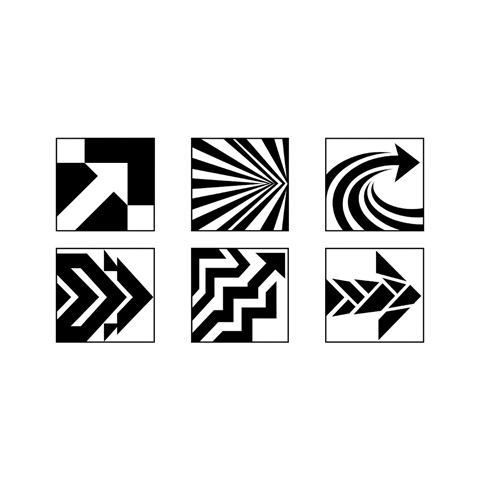</a><br><b>Arrow logos</b></td>
  </tr>
  <tr valign="top">
    <td align="center" width="33%"><a href="PROMPTS.md#sparkle-stars">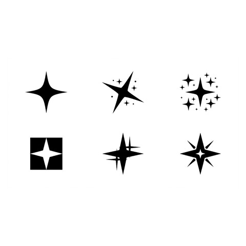</a><br><b>Sparkle stars</b></td>
    <td align="center" width="33%"><a href="PROMPTS.md#flame-icons">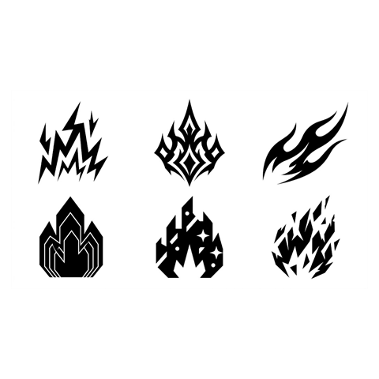</a><br><b>Flame icons</b></td>
    <td align="center" width="33%"><a href="PROMPTS.md#tribal-suns">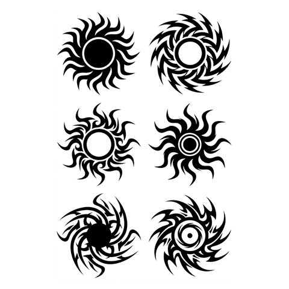</a><br><b>Tribal suns</b></td>
  </tr>
  <tr valign="top">
    <td align="center" width="33%"><a href="PROMPTS.md#rotational-symmetry">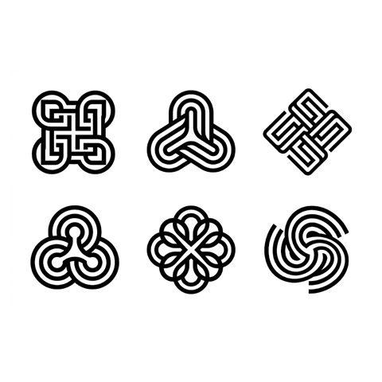</a><br><b>Rotational symmetry</b></td>
    <td align="center" width="33%"><a href="PROMPTS.md#liquid-blobs">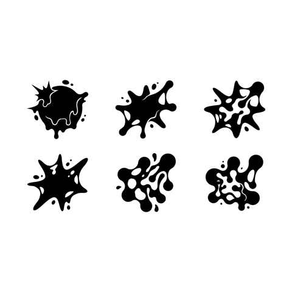</a><br><b>Liquid blobs</b></td>
    <td align="center" width="33%"><a href="PROMPTS.md#cyber-tribal-sigils">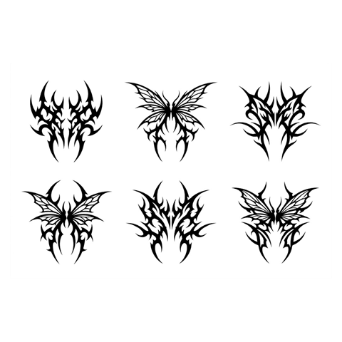</a><br><b>Cyber-tribal sigils</b></td>
  </tr>
  <tr valign="top">
    <td align="center" width="33%"><a href="PROMPTS.md#street-art-ornaments">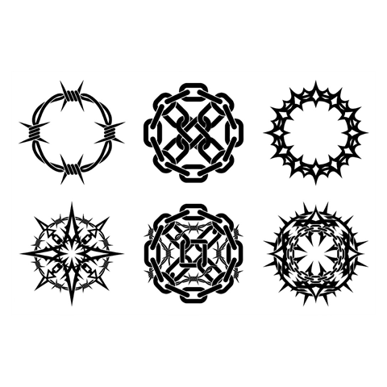</a><br><b>Street-art ornaments</b></td>
    <td align="center" width="33%"><a href="PROMPTS.md#pixel-os-icons">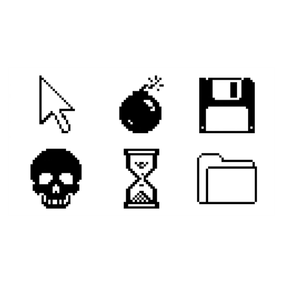</a><br><b>Pixel OS icons</b></td>
    <td align="center" width="33%"><a href="PROMPTS.md#pixel-arcade-glyphs">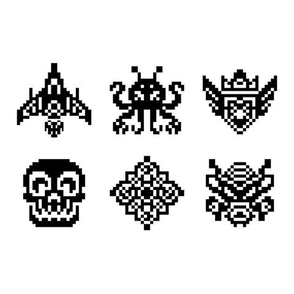</a><br><b>Pixel arcade glyphs</b></td>
  </tr>
  <tr valign="top">
    <td align="center" width="33%"><a href="PROMPTS.md#industrial-hazard">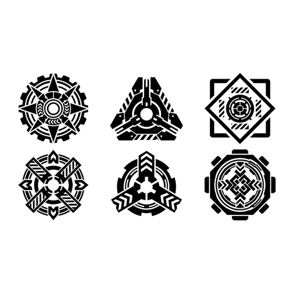</a><br><b>Industrial hazard</b></td>
    <td align="center" width="33%"><a href="PROMPTS.md#cargo-markings">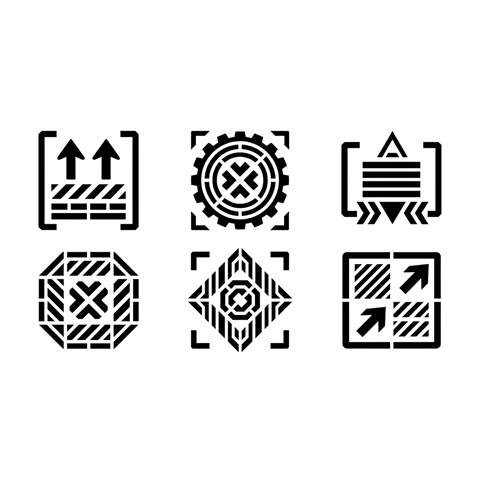</a><br><b>Cargo markings</b></td>
    <td></td>
  </tr>
</table>

## Как пользоваться

1. Открой [PROMPTS.md](PROMPTS.md) и найди нужную секцию — например, [Flame icons](PROMPTS.md#flame-icons).
2. Скопируй текст из блока **Промт**.
3. Вставь его в Nano Banana и запусти генерацию.
4. Результат можно донастраивать: количество иконок и формат сетки (`2x3`, `3x2`, `4x4`), тему, стиль, степень детализации. Всё, что должно остаться неизменным — монохром, белый фон, отсутствие текста — уже прописано в конце промта.

Промты самодостаточны: если убрать часть описания, модель начнёт импровизировать сильнее. Если нужен предсказуемый результат — не трогай хвост с ограничениями (`no gradients, no shadows, no text`).

## Структура репозитория

```text
nano-banano/
├── README.md          # описание и галерея
├── PROMPTS.md         # все промты
├── LICENSE            # MIT
└── assets/
    ├── banner.jpg     # баннер README
    ├── logos/         # полные изображения: логотипы
    ├── icons/         # полные изображения: иконки
    └── thumbs/        # квадратные превью 480 px для README
```

## Добавление промта

1. Положи результат в `assets/logos/` или `assets/icons/` — имя в kebab-case, например `my-new-icons.png`.
2. Сгенерируй квадратное превью 480×480 px — изображение вписывается на белом фоне — и сохрани в `assets/thumbs/my-new-icons.png`.
3. Добавь секцию в [PROMPTS.md](PROMPTS.md):

````markdown
### My new icons

Короткое описание в одну строку.


**Промт**

```text
Текст промта.
```
````

4. Добавь ссылку в оглавление `PROMPTS.md` и превью в галерею README.

## Лицензия

[MIT](LICENSE) © 2026 portal-deza. Используй, изменяй и распространяй свободно.
